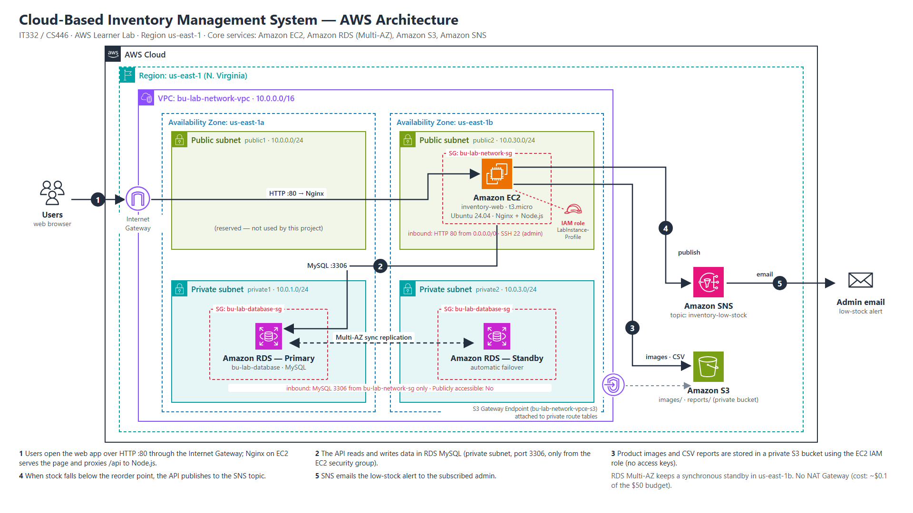

# Cloud-Based Inventory Management System

โปรเจกต์กลุ่มวิชา Cloud Computing (CS446/IT332) · Bangkok University
ระบบจัดการสต็อกสินค้าและคลังสินค้าบน AWS: **EC2 (Ubuntu 24.04) + Nginx · RDS MySQL Multi-AZ · S3 · SNS** (บน VPC แบบ Multi-AZ ตามแล็บ 7)

## แผนภาพสถาปัตยกรรม



บริการที่ใช้: Amazon EC2 · Amazon RDS (MySQL, Multi-AZ) · Amazon S3 · Amazon SNS — รายละเอียดเพิ่มเติมใน [`docs/ARCHITECTURE.md`](docs/ARCHITECTURE.md) และขั้นตอนติดตั้งใน [`docs/DEPLOY.md`](docs/DEPLOY.md)

## โครงสร้างโฟลเดอร์

```
inventory-aws/
├── README.md
├── database/
│   └── schema.sql              # ตารางทั้งหมด (MySQL 8.x)
├── backend/                    # Node.js + Express
│   ├── package.json
│   ├── .env.example            # คัดลอกเป็น .env
│   ├── scripts/seed-admin.js   # สร้างผู้ใช้ admin
│   └── src/
│       ├── server.js           # จุดเริ่มต้น, เชื่อม route, error handler
│       ├── db.js               # MySQL connection pool (RDS)
│       ├── s3.js               # อัปโหลด/ลบ/สร้างลิงก์ชั่วคราว (S3)
│       ├── sns.js              # ส่งแจ้งเตือนสินค้าใกล้หมด (SNS)
│       ├── middleware/auth.js  # ตรวจ JWT, สิทธิ์ admin
│       └── routes/             # auth, categories, products, stock, history, dashboard, reports
├── frontend/                   # หน้าเว็บ (HTML/CSS/JS ล้วน ไม่ต้อง build)
│   ├── index.html
│   ├── style.css
│   └── app.js
├── deploy/
│   ├── nginx/inventory.conf    # Nginx: static + reverse proxy /api/
│   └── systemd/inventory.service
└── docs/
    ├── DEPLOY.md               # ขั้นตอน Deploy ตั้งแต่สร้าง VPC ถึงรันระบบ (ใช้เป็นเอกสารส่งอาจารย์ได้)
    └── ARCHITECTURE.md         # แผนภาพสถาปัตยกรรม, ER Diagram, สรุป API
```

## เริ่มต้นเร็ว

- **Deploy ขึ้น AWS (สำหรับทีมที่ทดสอบโปรเจกต์นี้ ใช้เวลาประมาณ 35–45 นาที):** อ่าน [`docs/DEPLOY.md`](docs/DEPLOY.md)
- **ดูเป็นภาพทีละขั้น:** [คู่มือติดตั้งแบบสไลด์ภาพ 16 หน้า](https://claude.ai/artifact/LaitF9ckP2U7dUkWRinsx4) ใช้คู่กับ DEPLOY.md
- **รันทดสอบบนเครื่องตัวเอง:** ต้องมี MySQL 8 และ S3 bucket ที่เข้าถึงได้ด้วย AWS credentials ในเครื่อง
  ```bash
  mysql -u root -p < database/schema.sql
  cd backend && npm install && cp .env.example .env   # แก้ค่าใน .env
  npm run seed -- admin 'password1234' 'ผู้ดูแลระบบ'
  npm run dev                                         # API ที่ 127.0.0.1:3000
  ```
  หน้าเว็บเรียก `/api/...` แบบ same-origin จึงต้องผ่าน Nginx หรือ reverse proxy ถ้าเปิดไฟล์ตรง ๆ จะเรียก API ไม่ได้

## ความปลอดภัยที่ทำไว้

- รหัสผ่านเก็บเป็น bcrypt hash, ยืนยันตัวตนด้วย JWT, ลบสินค้าได้เฉพาะ admin
- ทุก query ใช้ parameterized statement (กัน SQL injection), หน้าเว็บ escape HTML ทุกจุดที่แสดงข้อมูลผู้ใช้
- อัปโหลดรูปจำกัดชนิด (JPG/PNG/WEBP) และขนาด 5MB, S3 bucket เป็น private ใช้ presigned URL
- ไม่มี Access Key ในโค้ด ใช้ Instance Profile, RDS อยู่ Private Subnet และรับการเชื่อมต่อจาก Security Group ของ EC2 เท่านั้น
- Node.js ฟังเฉพาะ `127.0.0.1` เข้าถึงจากภายนอกผ่าน Nginx เท่านั้น

## ข้อจำกัดที่ตั้งใจไว้ (ขยายต่อได้)

- รองรับคลังเดียว (ใช้ฟิลด์ `location` ระบุตำแหน่ง) ถ้าต้องการหลายคลังให้เพิ่มตาราง `warehouses` และ `stock_levels`
- ยังไม่มี HTTPS (เดโมใน Learner Lab) ถ้าจะใช้จริงให้ใส่ ALB + ACM หรือ Certbot กับโดเมน
- ยังไม่มีหน้าจัดการผู้ใช้ ให้เพิ่มผู้ใช้ `staff` ด้วย SQL หรือต่อยอดจาก `scripts/seed-admin.js`
