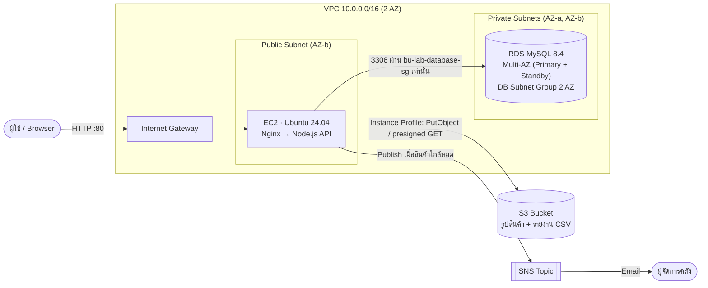
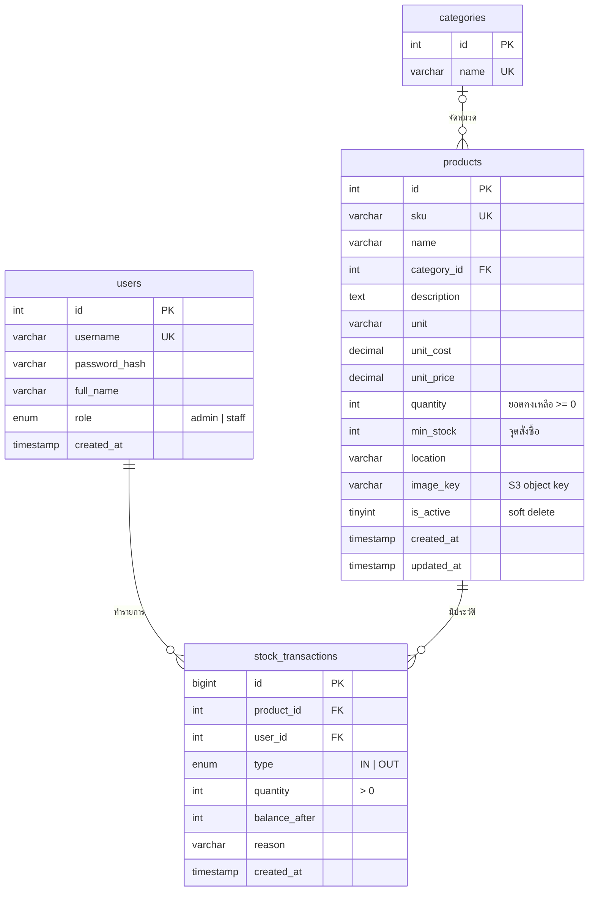

# สถาปัตยกรรมและ ER Diagram

## 1) AWS Architecture (สำหรับสไลด์เดโม)

**อธิบายทีละส่วน (ใช้พูดตอนเดโม):**

| ส่วน | เหตุผลการออกแบบ |
|------|-----------------|
| Public Subnet + EC2 | จุดเดียวที่รับทราฟฟิกจากอินเทอร์เน็ต เปิดแค่พอร์ต 80 (และ 22 เฉพาะ IP ผู้ดูแล) |
| Nginx | เสิร์ฟหน้าเว็บ static และ Reverse Proxy `/api/` ไป Node.js ที่ฟังเฉพาะ `127.0.0.1` ภายนอกเข้า API ตรงไม่ได้ |
| Private Subnet + RDS | ฐานข้อมูลไม่มี Public IP, `bu-lab-database-sg` รับ 3306 จาก `bu-lab-network-sg` เท่านั้น (Least Privilege) |
| RDS Multi-AZ | มี Standby คนละ AZ สลับอัตโนมัติเมื่อ Primary ล่ม (High Availability) |
| S3 (private) | เก็บรูปและรายงาน เข้าถึงผ่านลิงก์ชั่วคราว (presigned URL) ไม่เปิดสาธารณะ |
| Instance Profile | ไม่ฝัง Access Key ในโค้ด/เครื่อง |
| SNS | แจ้งเตือนสินค้าใกล้หมดทางอีเมล (ส่งเมื่อยอดเพิ่ง "ข้าม" จุดสั่งซื้อ จึงไม่ส่งรัวทุกครั้ง) |
| ไม่มี NAT Gateway | EC2 อยู่ Public Subnet และ RDS ไม่ต้องออกเน็ต จึงประหยัดงบ $50 ได้มาก |

## 2) การตอบโจทย์ (Requirement Mapping)

| ข้อกำหนดอาจารย์ | ในโปรเจกต์นี้ |
|-----------------|---------------|
| ≥ 4 AWS services (ไม่นับสีม่วง/networking) | EC2, RDS, S3, SNS |
| Working application ที่มีประโยชน์ | ระบบสต็อกสินค้า: Dashboard, CRUD, รับเข้า/ตัดจ่าย, ประวัติ |
| Architecture diagram (เดโม) | แผนภาพข้างบน |
| เอกสารที่กลุ่มอื่นทำตามได้ | `docs/DEPLOY.md` |

## 3) ER Diagram

**แนวคิดสำคัญ:**
- `products.quantity` เป็นยอดปัจจุบัน แก้ได้เฉพาะผ่าน `stock_transactions` (ทำใน DB transaction เดียวกัน) ประวัติจึงตรงกับยอดเสมอ
- `stock_transactions` เพิ่มอย่างเดียว ไม่มีแก้/ลบ เพื่อใช้เป็นหลักฐานตรวจสอบย้อนหลัง
- ลบสินค้าเป็น soft delete (`is_active = 0`) ไม่ทำให้ประวัติหาย
- ยอดตัดจ่ายถูกล็อกด้วย `SELECT ... FOR UPDATE` กันตัดสต็อกซ้อนกันจนติดลบ และมี `CHECK (quantity >= 0)` เป็นด่านสุดท้าย

## 4) API สรุป (ทุกเส้นยกเว้น `/api/health` และ `/api/auth/login` ต้องแนบ `Authorization: Bearer <token>`)

| Method | Path | หน้าที่ |
|--------|------|---------|
| GET | `/api/health` | ตรวจ API และการต่อ DB |
| POST | `/api/auth/login` | เข้าสู่ระบบ รับ JWT |
| GET | `/api/dashboard` | ตัวเลขสรุป, สินค้าใกล้หมด, รายการล่าสุด |
| GET / POST | `/api/categories` | ดู/เพิ่มหมวดหมู่ |
| GET | `/api/products?q=&category_id=&low_stock=1&page=&limit=` | ค้นหา/แบ่งหน้า |
| POST | `/api/products` | เพิ่มสินค้า (multipart, ฟิลด์รูปชื่อ `image`) |
| PUT | `/api/products/:id` | แก้ไข/เปลี่ยนรูป |
| DELETE | `/api/products/:id` | ลบ (admin เท่านั้น) |
| POST | `/api/stock/in` · `/api/stock/out` | `{product_id, quantity, reason}` |
| GET | `/api/history?type=&from=&to=&product_id=` | ประวัติรายการ |
| GET | `/api/reports/export` | สร้าง CSV เก็บ S3 แล้วคืนลิงก์ |
